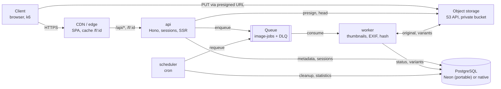
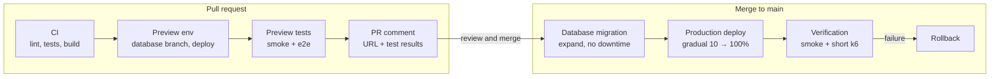

# hostmark reference application specification

> Version of 2026-10-31. Originally drafted in Polish under the working name `deploy-bench`.
>
> Where this document and [`decisions.md`](decisions.md) disagree, **`decisions.md` wins**. It records
> every resolved ambiguity and deliberate deviation.

## Goal and scope

hostmark is a service for uploading and processing images, deployed identically on many platforms so
they can be compared against an evaluation framework. The application has to be complex enough to
force the use of a queue, a database, object storage, cron and CPU work, yet simple enough not to
distract from the platforms.

In scope:

- SaaS frontend: landing page, login, a panel with upload and gallery, and a server-rendered public
  share page
- image upload through a presigned URL, directly to storage
- asynchronous processing in a worker: thumbnails, EXIF removal, hash
- reading metadata and the list of files
- recurring jobs: cleaning up expired files, daily statistics
- CDN for static assets, thumbnails and public pages, plus measurement from several world regions
- a multi-region variant where the platform supports it
- OpenTelemetry telemetry with one trace from the request to the worker, and Web Vitals from the
  browser
- two variants per platform: portable and idiomatic

Out of scope: payments, teams and roles, video, multi-region database writes (multi-primary).

## Architecture



The panel and landing page are served from the CDN, while `/api/*` and `/f/:id` pages reach the api
(the latter cached at the edge). The file goes straight to storage; the api only issues the presigned
URL and puts a job on the queue. Services never call each other: they are connected by the queue, the
database and storage, and the scheduler cleans up and retries stuck jobs.

## Stack and repository structure

TypeScript in a pnpm monorepo; the logic in `packages/core` imports nothing platform-specific.

| Layer | Choice | Notes |
| --- | --- | --- |
| Language and runtime | TypeScript, ESM, Node 22 / Workers / Bun | the same core code everywhere |
| HTTP | Hono | adapters for Workers, Node, Lambda, Vercel |
| Frontend (panel) | React + Vite, TanStack Router and Query | static SPA, hosted from a CDN |
| Frontend (public pages) | Hono JSX, SSR in api | `/f/:id` with OG tags, cached on the CDN |
| UI login | Better Auth (email + password), sessions in Postgres | API keys remain for k6 and integrations |
| Validation and contract | Zod + `@hono/zod-openapi` | OpenAPI generated from code, typed client for the frontend |
| Database | PostgreSQL + Drizzle ORM | migrations in `packages/db` |
| Database driver | `postgres` (Node), `@neondatabase/serverless` or Hyperdrive (Workers) | chosen in the adapter |
| Storage | S3 API through `aws4fetch` | also works on Workers |
| Image processing | portable: WASM library (e.g. jSquash); idiomatic: `sharp` or a platform service | compared separately |
| Telemetry | OpenTelemetry (traces, metrics, logs) + `web-vitals` in the browser | OTLP export to one backend |
| Load testing | k6 (API) + k6 browser or Playwright (frontend) | run from GitHub Actions and several regions |
| IaC | Terraform where a provider exists, otherwise the native config file | |

```
hostmark/
├─ apps/
│  └─ web/           # React + Vite SPA (panel), builds to static files
├─ packages/
│  ├─ core/          # domain, use cases, ports (interfaces)
│  ├─ contract/      # Zod schemas, OpenAPI, message types, API client
│  ├─ db/            # Drizzle schema, migrations, seed
│  ├─ image/         # image processing: wasm and sharp behind one interface
│  ├─ pages/         # SSR for public pages (Hono JSX): landing, /f/:id
│  └─ telemetry/     # shared OTel configuration, context propagation
├─ adapters/
│  ├─ cloudflare/    # api, worker, scheduler, assets + wrangler.toml
│  ├─ vercel/
│  ├─ aws/
│  ├─ gcp/
│  ├─ railway/
│  ├─ fly/
│  └─ vps/           # docker compose + Coolify or Kamal
├─ load/             # k6 scenarios and browser tests
├─ telemetry/        # dashboards, alerts
└─ .github/workflows/
```

## Ports and adapters

The core knows only the interfaces below; each platform adapter provides their implementations and
assembles the application in its entrypoint.

```ts
// packages/core/src/ports.ts
export interface Queue {
  send(msg: JobMessage, opts?: { delaySeconds?: number }): Promise<void>;
  sendBatch(msgs: JobMessage[]): Promise<void>;
}

// the consumer is inverted: the platform calls the handler, the handler does not poll
export type JobHandler = (msg: JobMessage, ctx: JobContext) => Promise<void>;
export interface JobContext {
  attempt: number;          // 1..maxAttempts
  receivedAt: Date;
}

export interface ObjectStorage {
  presignPut(key: string, contentType: string, maxBytes: number, ttlSeconds: number): Promise<string>;
  presignGet(key: string, ttlSeconds: number): Promise<string>;
  get(key: string): Promise<Uint8Array | null>;
  put(key: string, body: Uint8Array, contentType: string): Promise<void>;
  head(key: string): Promise<{ size: number; contentType: string } | null>;
  delete(keys: string[]): Promise<void>;
}

export interface ImageProcessor {
  readonly impl: 'wasm' | 'sharp' | 'platform';
  process(input: Uint8Array, sizes: number[]): Promise<{
    width: number; height: number;
    variants: { size: number; body: Uint8Array; bytes: number }[];
  }>;
}

export interface Clock { now(): Date }

// database: Drizzle with an injected driver, no custom abstraction
export type Db = import('@hostmark/db').Database;
```

Rules:

- An adapter must be thin: no business logic beyond mapping platform types onto ports.
- Each adapter has a contract test from `packages/core/test/contract`, run locally on an emulator or in
  docker compose.
- All platform-specific APIs used in an adapter are listed in its README (criterion G of the
  evaluation framework).

## API

REST with JSON, authorization with the `Authorization: Bearer <api_key>` header; the key is compared
by the SHA-256 hash stored in the `api_keys` table.

| Method and path | What it does | Test scenario |
| --- | --- | --- |
| `GET /health` | 200 without database access | baseline of platform overhead |
| `GET /health/deep` | pings database, storage and queue | readiness, monitoring |
| `POST /uploads` | creates a `files` row (status `pending_upload`), returns `fileId` and a presigned PUT URL | database write + presign |
| `POST /uploads/:id/complete` | checks `head` in storage, sets `queued`, sends a job to the queue | write + enqueue |
| `GET /files/:id` | metadata, status, presigned GET for variants | database read |
| `GET /files?cursor=&limit=50` | list of the key's files, cursor pagination | heavier read |
| `DELETE /files/:id` | soft delete, the scheduler removes the files | write |
| `GET /stats` | daily aggregates; in the variant with a stats service called synchronously | private network |
| `POST /debug/cpu?ms=` | hashing loop for the given time; admin key only | CPU limits |

Input limits: types `image/jpeg`, `image/png`, `image/webp`; at most 10 MB; presigned URL valid for 10
minutes.

Error format (RFC 9457, `application/problem+json`): `type`, `title`, `status`, `detail`, `traceId`.

| Code | When |
| --- | --- |
| 400 | Zod validation error |
| 401 | missing or wrong key |
| 404 | file does not exist or belongs to another key |
| 409 | `complete` for a file in the wrong status or without an object in storage |
| 413 | declared size > 10 MB |
| 429 | request limit per key exceeded (optional) |

Every response has the `x-trace-id` and `x-platform` headers (e.g. `cloudflare-portable`) so k6 can
log them. Additionally an `x-version` header with the commit SHA, used in the deploy propagation test
(S14).

## Frontend

The frontend must look and behave like a typical small SaaS: a static panel from the CDN, public pages
rendered server-side and cached at the edge, login via a session in a cookie.

| Page | Rendering | CDN cache | What it tests |
| --- | --- | --- | --- |
| `/` landing and `/pricing` | static HTML from the build | 1 year for hashed assets, 5 min for HTML | TTFB and LCP from different regions, static hosting |
| `/login`, `/signup` | SPA | static assets | cookies, sessions, CSRF |
| `/app` panel | SPA, data from `/api/*` | no caching of API responses | drag & drop upload with a progress bar, thumbnail gallery |
| `/app/files/:id` | SPA | none | details, live status |
| `/f/:id` public share | SSR in api (Hono JSX) | `s-maxage=60, stale-while-revalidate=600` | SSR at the edge vs in a region, cache hits, OG tags |
| thumbnails | from storage via CDN | 1 year, immutable key | CDN for images, egress |

Live status: by default Server-Sent Events from `GET /api/files/:id/events`, with an automatic fallback
to polling every 2 s. Whether SSE works on a given platform (response time limits, buffering) is a
separate evaluation point.

Additional API endpoints:

| Method and path | What it does |
| --- | --- |
| `/api/auth/*` | signup, login, logout (Better Auth), session in an `HttpOnly`, `SameSite=Lax` cookie |
| `GET /api/files/:id/events` | SSE with status changes |
| `POST /api/rum` | accepts Web Vitals from the browser (LCP, INP, CLS, TTFB), turns them into OTel metrics |
| `GET /f/:id` | public SSR page, only for files marked public |

Routing: the frontend and API run on one domain (`/api/*` to api, the rest to static assets) to avoid
CORS and to also compare platform routing. The `files.is_public boolean default false` column controls
availability of `/f/:id`.

## CDN, cache and multi-region

Each platform is tested in two layouts: single-region (Frankfurt, the default) and multi-region (where
the platform allows it). Multi-region concerns compute and reads; database writes always go to one
primary region in Frankfurt.

Measurement regions: Warsaw (or Frankfurt), US East (Virginia), Asia (Singapore). Tests from each region
run in parallel, e.g. through GitHub Actions on runners in those regions or through distributed k6.

Multi-region layout:

- api compute in 3 regions (or globally at the edge, if that is how the platform works)
- reads from a database replica in the nearest region, if the platform or database offers read
  replicas; writes always to the primary
- worker and scheduler in one region, next to the primary database
- storage in one region, thumbnails distributed via CDN

What we measure:

- TTFB of the static page and LCP of the landing page from each region
- latency of `GET /api/files/:id` from each region in single and multi layouts
- `/f/:id`: response time on a CDN cache hit and miss, hit ratio
- propagation time of a new deploy across all regions
- cache purge time and whether it can be triggered from an API
- whether a custom domain and TLS work automatically, and what CDN transfer costs

Cache rules:

- API responses with `Cache-Control: private, no-store`
- assets with a hash in the name `public, max-age=31536000, immutable`
- static HTML `public, max-age=300`
- `/f/:id` as in the frontend table
- cache status headers (e.g. `cf-cache-status`, `x-vercel-cache`, `x-cache`) recorded by k6 unchanged

## Database schema

PostgreSQL, four tables; in the portable variant the database is Neon in AWS eu-central-1 (Frankfurt),
with autosuspend disabled for the duration of latency tests.

```sql
create table api_keys (
  id          uuid primary key default gen_random_uuid(),
  key_hash    text not null unique,          -- sha256 hex
  name        text not null,
  is_admin    boolean not null default false,
  created_at  timestamptz not null default now()
);

create type file_status as enum
  ('pending_upload', 'queued', 'processing', 'ready', 'failed', 'deleted');

create table files (
  id            uuid primary key,              -- uuidv7, time sortable
  api_key_id    uuid not null references api_keys(id),
  status        file_status not null default 'pending_upload',
  content_type  text not null,
  bytes         integer,
  width         integer,
  height        integer,
  sha256        text,
  original_key  text not null,
  attempts      integer not null default 0,
  last_error    text,
  expires_at    timestamptz not null,          -- default +7 days
  created_at    timestamptz not null default now(),
  queued_at     timestamptz,
  ready_at      timestamptz,
  deleted_at    timestamptz
);
create index files_key_created on files (api_key_id, id desc) where deleted_at is null;
create index files_expires on files (expires_at) where deleted_at is null;
create index files_sha on files (sha256);

create table file_variants (
  file_id     uuid not null references files(id) on delete cascade,
  size        integer not null,                -- longer side in px: 128, 512, 1600
  storage_key text not null,
  bytes       integer not null,
  primary key (file_id, size)
);

create table daily_stats (
  day               date not null,
  platform          text not null,
  uploads           integer not null,
  ready             integer not null,
  failed            integer not null,
  bytes_in          bigint not null,
  p50_processing_ms integer,
  p95_processing_ms integer,
  primary key (day, platform)
);
```

- `ready_at - queued_at` is the end-to-end processing time from which daily statistics are computed.
- Status transitions use a conditional `update ... where status = <expected>`, which gives idempotency
  without additional locks.
- The seed creates one regular key and one admin key; the key values go into platform secrets, not the
  repository.

Changes for the frontend:

```sql
-- the user, session, account, verification tables are generated by Better Auth (Drizzle adapter)
alter table api_keys add column user_id text not null references "user"(id);
alter table files    add column user_id text not null references "user"(id);
alter table files    add column is_public boolean not null default false;
alter table files    alter column api_key_id drop not null;
create index files_user_created on files (user_id, id desc) where deleted_at is null;
```

A file's owner is the user; `api_key_id` remains as information about which key uploaded the file (null
for uploads from the panel).

## Queue

One job queue `image-jobs` and one dead letter queue `image-jobs-dlq`. Semantics are at-least-once, so
every job must be idempotent.

```ts
// packages/contract/src/messages.ts
export const JobMessage = z.object({
  v: z.literal(1),
  type: z.enum(['process_image', 'delete_file']),
  jobId: z.string().uuid(),        // unique per send
  fileId: z.string().uuid(),
  enqueuedAt: z.string().datetime(),
  traceparent: z.string().optional(),  // W3C Trace Context
  tracestate: z.string().optional(),
  chaos: z.enum(['none', 'fail', 'crash', 'slow']).default('none'),
});
```

| Parameter | Value |
| --- | --- |
| Maximum attempts | 5 |
| Backoff | exponential: 10 s, 30 s, 90 s, 270 s |
| Visibility timeout / ack deadline | 60 s |
| Consumer batch | up to 10 messages, if the platform allows it |
| After attempts are exhausted | message to DLQ, `files.status = failed`, metric `jobs_dead_lettered` |

Idempotency: the worker first runs `update files set status = 'processing' where id = $1 and status in
('queued', 'processing')`. No row means the file is already `ready`, `failed` or `deleted`, so the
message is acknowledged without work. Variant keys in storage are deterministic, so a repeated write
overwrites the same object.

The `chaos` field is set only by an admin key (the `x-chaos` header on `complete`) and is used for
failure tests:

- `fail`: the handler always throws, tests retry and DLQ
- `crash`: on the first attempt the process exits without ack, tests redelivery
- `slow`: the handler waits 45 s, tests timeouts and concurrency

Trace propagation: the producer writes `traceparent` into the message, the consumer creates a span with
a link to that context.

## Storage

One private bucket per deployment, access only through presigned URLs; the common denominator is the S3
API (R2, S3, GCS in interoperable mode, Tigris, MinIO).

Key layout (deterministic, enables idempotent writes):

```
originals/{apiKeyId}/{fileId}
variants/{apiKeyId}/{fileId}/{size}.webp     # size: 128, 512, 1600
```

Presigned URLs:

- PUT: valid for 10 minutes, signed with `Content-Type` and a size limit where the platform supports it
  (S3 and R2 through `Content-Length` in the signature)
- GET: valid for 1 hour, generated on each `GET /files/:id`
- on platforms without size limits in the signature, the size is checked by `head` in `complete` and a
  file > 10 MB gets a 413 and is deleted

Lifecycle:

- the scheduler removes objects of files with `deleted_at` or past `expires_at`
- a bucket lifecycle rule removes `originals/` older than 8 days as a safeguard in case the scheduler
  does not run
- `pending_upload` rows older than 1 h are marked `deleted` (abandoned uploads)

Bucket CORS: PUT and GET from any origin, the `Content-Type` header allowed; only needed for a possible
browser client.

Idiomatic variant: instead of `POST /uploads/:id/complete`, native notifications of a new object (R2
event notifications → Queues, S3 events → SQS, GCS → Pub/Sub). The `complete` endpoint remains as a
fallback.

## Worker and scheduler

The worker performs one `process_image` job in seven steps; each step is a separate OTel span, to show
where a platform loses time.

1. Status transition `queued → processing`, increment `attempts` (idempotency, see Queue).
2. Download the original from storage.
3. Compute SHA-256; if a `ready` file with the same hash and the same API key exists, its variants are
   copied (deduplication).
4. Decode, remove EXIF, generate WebP variants of 128, 512 and 1600 px (longer side), without upscaling
   smaller images.
5. Write variants to storage.
6. Write `file_variants`, dimensions, `sha256` and `status = ready`, `ready_at = now()` in one
   transaction.
7. Ack the message and record the `processing_duration_ms` metric.

An error in steps 2–6 records `last_error` and throws, and the queue retries. Decoding an invalid image
is a permanent error: immediately `failed`, no retry.

The scheduler has three jobs, each idempotent and safe when run twice:

| Job | Schedule | What it does |
| --- | --- | --- |
| `cleanup-expired` | every 15 min | removes objects of files `deleted` or past `expires_at`, abandoned `pending_upload` |
| `requeue-stuck` | every 5 min | returns files in `queued` or `processing` longer than 10 min to the queue |
| `daily-stats` | 00:05 | computes `daily_stats` for the previous day |

(Schedule in UTC.) Each run writes a log with a `job` field, duration and number of processed records.
That gives the test for the "did cron run once and on time" criterion.

## Variants per platform

Each platform has two variants: portable (shared Neon database in Frankfurt, shared code, compares
compute alone) and idiomatic (native services, the way things are really done on that platform). The
queue is always native because there is no common denominator.

| Platform | Deployment units (api / worker / scheduler) | Queue | Storage | Idiomatic database | Idiomatic image |
| --- | --- | --- | --- | --- | --- |
| Cloudflare | 3 Workers (fetch / queue consumer / cron trigger) | Cloudflare Queues | R2 | D1 or Postgres through Hyperdrive | Cloudflare Images |
| Vercel | Functions / Functions from queue / Cron Jobs | Vercel Queues or external (to verify) | Vercel Blob or R2 | Neon from the Vercel integration | `sharp` in Node runtime |
| AWS | Lambda behind Function URL or API Gateway / Lambda from SQS / EventBridge Scheduler | SQS + DLQ | S3 | RDS or Aurora Serverless v2 | `sharp` in a Lambda layer |
| Google Cloud | Cloud Run service / Cloud Run with Pub/Sub push / Cloud Scheduler | Pub/Sub or Cloud Tasks | GCS | Cloud SQL | `sharp` in a container |
| Railway | 3 services from one repo | Redis + BullMQ or pg-boss | Railway Buckets or R2 | Railway Postgres | `sharp` |
| Fly.io | 3 processes in one app (`[processes]`) | Redis (Upstash) + BullMQ or pg-boss | Tigris | Fly Managed Postgres | `sharp` |
| VPS (Hetzner) | 3 containers, Coolify or Kamal | Redis + BullMQ or pg-boss | MinIO or R2 | Postgres in a container with backup | `sharp` |

Frontend, CDN and multi-region (state to be confirmed in documentation before implementation):

| Platform | Static and CDN | SSR `/f/:id` | Multi-region compute | Reads near the user | Cache purge |
| --- | --- | --- | --- | --- | --- |
| Cloudflare | Workers Static Assets, CF network | Worker at the edge or Smart Placement next to the database | global by nature | Hyperdrive with query cache or database replicas | API |
| Vercel | Vercel CDN | Function in a chosen region, CDN cache | several function regions on a paid plan | Neon replicas in regions | API or redeploy |
| AWS | S3 + CloudFront | Lambda behind CloudFront | Lambda in several regions + Route 53 latency routing | RDS replicas or Aurora Global Database | CloudFront invalidation |
| Google Cloud | Cloud Storage + Cloud CDN | Cloud Run behind a global load balancer | Cloud Run in several regions + global LB | Cloud SQL replicas | Cloud CDN API |
| Railway | served by the app, external CDN (e.g. Cloudflare) | api service | service replicas in several regions | to be checked | on the external CDN side |
| Fly.io | served by the app from the anycast proxy, external CDN optional | api process | machines in many regions | Postgres replicas + write forwarding to the primary region | on the external CDN side |
| VPS (Hetzner) | Cloudflare in front of the server | api container | manual: additional VPSes and load balancing (skipped by default) | none | Cloudflare API |

VPS deliberately stays single-region: it shows how much a free CDN in front of one server gives compared
to real multi-region.

Implementation notes:

- All native services in the table (especially Vercel Queues, Railway Buckets, Fly Managed Postgres) must
  be confirmed in current documentation before implementation; platform offerings change quickly.
- On platforms with long-lived processes the worker consumes the queue in a loop; on serverless the
  platform calls the handler. Both cases are served by the same `JobHandler` from the core.
- In the portable variant the worker on Cloudflare uses WASM processing; on other platforms portable also
  uses WASM so the CPU comparison is fair.
- Region everywhere: nearest to Frankfurt; on Cloudflare without forcing a location, with a note in the
  results.
- Each adapter has a `README.md` listing the platform-specific APIs used and instructions for a
  one-command deploy.

## Telemetry

All variants send traces, metrics and logs over OTLP to one backend (e.g. Grafana Cloud), so results are
comparable regardless of platform tooling. Native platform tools are evaluated separately, in criterion
D.

Resource attributes on every signal: `service.name` (`api`, `worker`, `scheduler`),
`deployment.environment`, `bench.platform` (e.g. `aws`), `bench.variant` (`portable` or `idiomatic`),
`bench.image_impl`, `service.version` (commit SHA).

Spans:

- api: HTTP span from Hono, spans for database queries, presign, enqueue
- the producer writes `traceparent` and `tracestate` into the message
- the worker creates a `process_image` span with a link to the producer's context, and child spans for
  the 7 steps
- scheduler: one span per job run

Metrics:

| Metric | Type | Meaning |
| --- | --- | --- |
| `http.server.request.duration` | histogram | api latency by route and code |
| `bench.cold_start` | counter | first request in a new instance (module variable flag) |
| `queue.enqueue_to_start_ms` | histogram | from `enqueuedAt` to handler start |
| `processing_duration_ms` | histogram | worker processing time |
| `upload_to_ready_ms` | histogram | `ready_at - queued_at` |
| `jobs_retried`, `jobs_dead_lettered` | counter | retry and DLQ |
| `scheduler_run_duration_ms` | histogram | by job |

Logs: single-line JSON with `traceId`, `spanId`, `level`, `msg`, `fileId`. On platforms where OTLP log
export is hard, the log goes to stdout and collecting it is part of the evaluation.

Frontend: the `web-vitals` library sends LCP, INP, CLS and TTFB to `POST /api/rum` with the attributes
`bench.platform`, `bench.variant`, `bench.topology` (`single` or `multi`) and the client region. Fetch
from the panel passes `traceparent`, so the trace starts in the browser.

Baseline alerts (the same for all variants): `GET /health` from an external probe every 1 min, error
rate > 5% for 5 min, DLQ > 0, no `daily-stats` run by 00:30 UTC.

## CI/CD and preview environments

All platforms get the same GitHub Actions pipeline template; where the platform has its own git
integration (e.g. Vercel, Cloudflare, Railway), both ways are tested and compared in criterion A.



Closing a PR without merging removes the whole preview: database branch, storage prefix, queue and
deploy.

Pipeline:

| Stage | What it does | What is measured |
| --- | --- | --- |
| CI | lint, typecheck, unit and contract tests, build of all packages | time, build cache |
| Preview | creates a complete PR environment (list below) and deploys | time from push to a working URL |
| Preview tests | smoke test upload → `ready`, browser test S13 | time, test flakiness |
| PR comment | URL, version, test result, link to trace | whether the platform does this itself |
| Production migration | `drizzle-kit migrate`, backward compatible changes only (expand) | time, table locks |
| Production deploy | gradual (e.g. 10% → 100%) if the platform supports it; otherwise all at once | commit → production time, errors during rollout |
| Verification | smoke test and a 2-minute S1 + S2 on production | p95 before and after |
| Rollback | automatic when verification fails | time, what happens to the migration |

Complete preview environment for PR number n:

- frontend, api and worker; scheduler off or every 1 h
- separate queue `image-jobs-pr-n`, or a prefix in a shared queue if the platform does not allow otherwise
- database: a Neon branch from the production schema and seed (portable) or a native mechanism (idiomatic)
- storage: prefix `pr-n/` in the preview bucket
- own preview secrets, with no access to the production database, queue and bucket
- address `pr-n.<domain>` or a platform-assigned URL
- everything removed after the PR closes, plus a 7-day TTL for abandoned ones

What we evaluate in preview:

- whether the platform creates a preview itself and what is missing from it (frontend only, frontend +
  backend, everything including database and queue)
- time to readiness
- cost of one preview per day
- isolation from production
- whether 24 h after closing the PR no resources remain (database branches, queues, objects, deploys)

CI secrets: OIDC from GitHub Actions preferred over long-lived keys. For each platform we note whether
OIDC is available, how many secrets must be stored in GitHub and what their permission scope is.

Pipeline acceptance criteria:

- opening a PR produces a working preview with a comment
- closing a PR cleans up everything
- merging to `main` deploys production without manual steps
- failed verification restores the previous version

## Maintenance tasks

Maintenance is compared on the same set of typical tasks, performed on each platform and measured with a
stopwatch. In addition there is an event log from 2–3 months (category H of the evaluation framework).

| ID | Task | Description | What is measured |
| --- | --- | --- | --- |
| M1 | Dependency update | Renovate PR with minor bumps and one major, through the whole pipeline | time to production, manual fixes |
| M2 | Runtime update | Node 22 → 24, and on Workers a `compatibility_date` bump | time, configuration changes, downtime |
| M3 | Zero-downtime schema migration | column rename by expand → backfill → contract under S2 traffic | errors during migration, time |
| M4 | Secret rotation | new database password and new storage key under S2 traffic | downtime, number of places to change |
| M5 | New environment variable | added in all environments, including preview | time, whether it requires a redeploy |
| M6 | Error diagnosis | deliberately introduced bug in the worker (1% of jobs fail), finding the cause with platform tools only, then with OTel | time from alert to cause |
| M7 | Scaling | raising worker limits and concurrency for S5 | time, whether it requires a plan change |
| M8 | Domain and certificate | attaching a new domain with TLS | time to working HTTPS |
| M9 | Rebuilding from scratch | new account or project, deploy from repo and IaC, data restore | time, manual steps |
| M10 | Decommissioning | removing the whole environment and checking billing after 48 h | leftover resources and orphan costs |

Maintenance log (`maintenance-log.csv` in the repo, one row per event or task):

```csv
date,platform,variant,type,id,description,minutes,downtime_min,manual_steps,notes
2026-11-03,cloudflare,portable,task,M2,compatibility_date bump,12,0,1,
2026-11-10,aws,portable,incident,,SQS visibility timeout too low,45,0,3,
```

Maintenance hours per month per platform are computed from the log; that is the main number of category
H.

## Test scenarios

k6 scenarios are shared across all variants; only `BASE_URL` and the key change. Each run saves its
result as JSON with `x-platform`, date and commit SHA.

Preparation (`setup()`): waking up the database (`GET /health/deep`) and one warm-up request per route,
except for the cold start scenario.

| ID | Scenario | Load | Metrics |
| --- | --- | --- | --- |
| S1 | Baseline `GET /health` | 50 rps for 3 min | p50 / p95 / p99, errors |
| S2 | Read `GET /files/:id` | 50 rps for 3 min | latency with database |
| S3 | List `GET /files?limit=50` | 20 rps for 3 min | heavier read |
| S4 | End-to-end upload (1 MB JPEG) | 2 rps for 5 min | api latency, `upload_to_ready_ms` |
| S5 | Upload burst | 1000 uploads in 60 s | queue drain time, worker scaling |
| S6 | Traffic spike on S2 | 0 → 500 rps in 10 s, 2 min | stabilisation time, % errors |
| S7 | Cold start | 1 request after 5, 15 and 60 min of silence, 10 repeats | first request time, separately with cold and warm database |
| S8 | CPU limit `POST /debug/cpu` | 100, 500, 1000, 5000 ms | whether the request passes and what it costs |
| S9 | Large file | 10 MB PNG | processing time, memory limits |

Frontend and reach scenarios (from 3 regions in parallel, in single and multi layouts):

| ID | Scenario | Load | Metrics |
| --- | --- | --- | --- |
| S10 | Landing `/` in a browser | 20 visits from each region, clean browser state | TTFB, LCP, transfer size |
| S11 | `GET /api/files/:id` from 3 regions | 20 rps from each for 3 min | p50 / p95 per region, single vs multi |
| S12 | `/f/:id` with cold and warm cache | 1st request after purge, then 50 rps for 2 min | MISS vs HIT time, hit ratio |
| S13 | User flow in the panel | login → upload → status `ready` → gallery, 10 runs | whole flow time, INP, SSE behaviour |
| S14 | Deploy propagation | version change and polling `x-version` from 3 regions every 1 s | time to new version everywhere |
| S15 | Cache purge | purge `/f/:id` through the API and polling from 3 regions | time to MISS everywhere |

Failure tests (manual, results described in categories C, D and H):

| ID | Test | Expected |
| --- | --- | --- |
| F1 | `chaos=fail` | 5 attempts with backoff, message in DLQ, status `failed`, alert DLQ > 0 |
| F2 | `chaos=crash` | redelivery, the file ends up `ready` |
| F3 | `chaos=slow` | no duplicate variants, correct behaviour at timeouts |
| F4 | Scheduler off for 1 h | `requeue-stuck` and `cleanup-expired` catch up after being turned back on |
| F5 | Database restore from backup | restore time, data completeness |
| F6 | Rollback to the previous version | time, number of errors during rollback |

Costs: before the first S5 and S6, budgets and billing alerts are set on every platform. The cost of each
run is read from billing after 24–48 h.

## Implementation order and acceptance criteria

Implementation proceeds in stages; each stage ends in a working state and corresponds to one or two
series entries.

- **E0. Core locally.** `packages/core`, `contract`, `db`, `image` (WASM), `telemetry`; `local` adapter in
  docker compose (Node + Postgres + MinIO + Redis/BullMQ). Unit and port contract tests.
- **E1. Frontend locally.** `apps/web` (SPA panel), `packages/pages` (landing, `/f/:id`), Better Auth
  login, SSE with status, Web Vitals.
- **E2.** k6 scenarios and browser tests running on the local variant, results saved to JSON.
- **E3. Cloudflare portable** (Workers + Static Assets + Queues + R2 + Neon through Hyperdrive or the Neon
  driver).
- **E4. CI/CD pipeline and per-PR preview for Cloudflare:** GitHub Actions template, Neon branches, PR
  comment, cleanup, gradual deploy and automatic rollback.
- **E5. Google Cloud Run portable** (the other pole: a container with a long-lived process, Cloud CDN),
  with the same pipeline from the start.
- **E6. Benchmark in GitHub Actions:** k6 from 3 regions, publishing results; monthly re-run.
- **E7. Further portable adapters with the pipeline:** AWS, Railway, Fly.io, Vercel, VPS.
- **E8. Multi-region layout** for platforms that support it.
- **E9. Idiomatic variants** for each platform, including native previews and git integration.
- **E10. Maintenance tasks** M1–M10, failure tests F1–F6 and keeping `maintenance-log.csv`.

Acceptance criteria for each adapter:

1. One-command deploy from a clean clone of the repo, described in the adapter's README.
2. Port contract tests pass, plus a smoke test: upload → `ready` in < 60 s.
3. The trace from `POST /uploads/:id/complete` to the end of `process_image` is visible as one run in the
   OTel backend.
4. All scenarios S1–S15 run with no change to test code; frontend and API work on one domain with TLS.
5. No secrets in the repo; secrets in the platform mechanism, list of variables in the README.
6. The README lists platform-specific APIs and known limitations.

Guidance for Claude Code:

- Start with E0 and do not touch adapters until core tests are green.
- Before implementing an adapter, check the current platform documentation (limits, service names, SDK
  versions) and record the findings in the adapter's README.
- Do not add business logic to adapters; if something does not fit the ports, change the port in the core
  and describe the change.
- Each adapter in a separate PR, with smoke test results in the description. (Superseded: see D1 in
  [`decisions.md`](decisions.md).)
